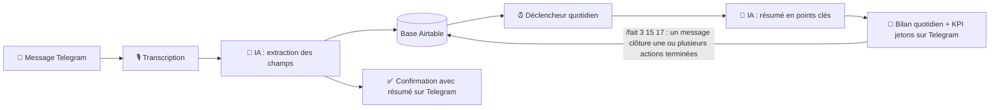
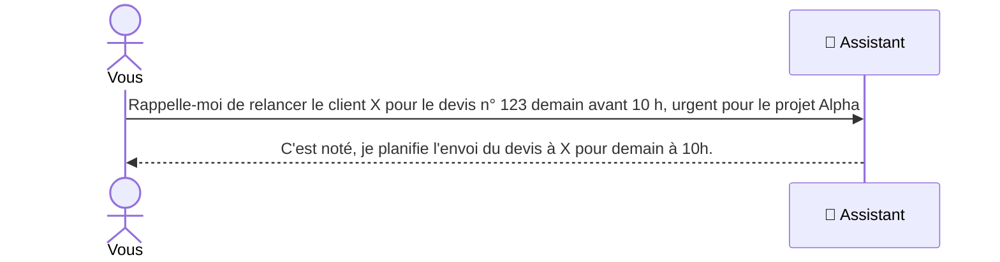

# 🗓️ Organisateur d'urgences : un assistant personnel no-code

> **Dictez une urgence, l'IA la classe, et chaque matin vous recevez votre journée résumée par texto.**

## ✨ En bref
- 🎤 **Zéro friction** : une urgence se dicte en une phrase, l'IA la structure toute seule
- 💬 **Via Telegram** : un simple message suffit, et une confirmation avec résumé arrive immédiatement
- ⏰ **Assistant permanent** : un bilan quotidien des urgences arrive par texto
- ✅ **Pilotable par message** : une commande suffit pour clôturer une action
- 🪙 **Pensé pour ses contraintes** : un système de jetons surveille la consommation de crédits AI pour pouvoir se piloter.

## 🎯 Le problème
Un auto-entrepreneur jongle entre des devis, des projets clients et des urgences de dernière minute.
Noter une relance dans un agenda classique demande d'ouvrir l'application, de chercher la bonne date,
la bonne heure, puis de tout saisir. Résultat : on repousse, on oublie, et l'urgence devient un problème.

## 💡 La solution
Un assistant permanent qui fonctionne avec une seule action : **envoyer un message, écrit ou vocal**.

**Exemple de message :**
> « Rappelle-moi de relancer le client X pour le devis n° 123 demain avant 10 h, c'est urgent pour le projet Alpha. »

**Ce que fait l'assistant :**
1. L'utilisateur envoie son message à l'assistant sur **Telegram**.
2. L'IA analyse la phrase et en extrait des champs structurés (client, action à mener, échéance, priorité, projet).
3. Les informations sont enregistrées automatiquement dans la base de données.
4. **Un message de confirmation avec résumé** est renvoyé aussitôt sur Telegram, pour vérifier que l'IA a bien compris.
5. **Chaque jour à heure fixe**, le bilan des urgences du jour et des prochaines 24 h arrive sur Telegram.

## 🔄 Fonctionnement



## 🔍 Les détails qui font la différence
Ce projet a été travaillé jusque dans ses détails. En résumé :

- 🔁 **Confirmation instantanée** : après chaque ajout, l'IA renvoie un résumé de ce qu'elle a compris
- ✅ **Clôture par message** : `/fait` ou `/done` suivi des numéros identifiants de l'actions, sans ouvrir aucune application
- 🗃️ **Historique conservé** : une action terminée quitte le bilan mais reste dans la base de données
- 🪙 **Budget mensuel flexible** : un système de jetons adapté aux crédits de la version gratuite de Make
- 📊 **Bilan = KPI** : chaque bilan se termine par le suivi du solde de jetons du mois
- ⚖️ **Un arbitrage assumé** entre confort d'usage et coût d'exploitation

Le détail de chacun est ci-dessous 👇

### Une confirmation après chaque ajout
Dès qu'une action est enregistrée, l'IA renvoie sur Telegram un **résumé de ce qu'elle a compris**.
L'utilisateur vérifie en une seconde que le client, l'échéance et la priorité sont corrects,
sans avoir à ouvrir la base de données.

**Exemple (contenu fictif) :**


### Clôturer une action d'un simple message
Chaque action du bilan quotidien possède un identifiant. Pour la clôturer, il suffit d'envoyer
`/fait 12` ou `/done 12`. On peut aussi en regrouper plusieurs : `/fait 3 15 17`.

- Le statut passe automatiquement de **To do** ou **In progress** à **Done**
- L'action **reste dans la base de données** (historique et analyses possibles)
- Elle **n'apparaît plus dans le bilan suivant**, qui reste lisible

### Un budget de jetons pensé pour la version gratuite de Make

> **La gratuité est ici une contrainte de conception étudiée**, et non une limite subie.
> Avec une licence **Core ou Pro de Make**, cette contrainte disparaît.

La version gratuite de Make offre **1 000 crédits par mois**, réinitialisés tous les 30 jours.
J'ai donc raisonné en **budget mensuel**, et non en quota quotidien rigide, pour ne jamais pénaliser l'utilisateur.
**Un jeton correspond à une action ajoutée.** Le budget est de **120 jetons par mois**, soit **3 actions par jour en moyenne**.
Ce chiffre n'est pas arbitraire : il a été calculé **après avoir réservé les crédits nécessaires** aux **messages de confirmation**, aux **clôtures groupées (`/fait`)** et au **bilan quotidien**, de façon à ce que l'ensemble tienne dans les 1 000 crédits du mois.
Seules les actions ajoutées font avancer le compteur ; tout le reste est déjà compté dans le budget.

**Moyenne conseillée, calculée sur le mois :**

| Action | Moyenne conseillée par jour | Compte dans le compteur ? |
|---|---|---|
| ➕ Ajout d'une urgence (1 message par urgence) | **3 actions distinctes** | ✅ Oui, 1 jeton par action |
| ✅ Clôture d'actions (`/fait`) | **1 message regroupant 3 actions ou plus** | ❌ Non, déjà inclus dans le budget |

**Une moyenne, pas un plafond.** L'application ne bloque jamais l'utilisateur à la troisième action :

- Il peut enregistrer **10 urgences un jour** s'il sait que les jours suivants seront plus calmes.
- Il peut envoyer **un `/fait` pour une seule action**, s'il prévoit d'en clôturer 7 d'un coup le lendemain.

Ce qui compte, c'est l'équilibre sur le mois.

### Le bilan quotidien comme tableau de bord (KPI)
Chaque bilan se termine par un **indicateur de suivi** : le solde de jetons du mois.
L'utilisateur voit en un coup d'œil où il en est et ajuste son rythme.

**Exemple de bilan reçu (contenu fictif) :**

```
Bilan du jour
1. [#3] Relancer le client X, devis n° 123 (avant 10 h) : URGENT
2. [#15] Envoyer la facture du projet Alpha
3. [#17] Préparer le rendez-vous de jeudi

# Jetons du mois : 14/90 * encore 76 Jetons disponibles
```
Dans cet exemple, **14 actions** ont été ajoutées ce mois-ci sur un budget de **90**, il reste donc **76 jetons**.

### Le compromis assumé
Regrouper les clôtures économise des jetons, mais le bilan peut afficher pendant 2 ou 3 jours
des actions déjà exécutées. J'ai choisi de privilégier un budget maîtrisé plutôt qu'une mise à jour instantanée.

> 💡 Ce choix vient de mon métier : toute solution a un coût d'exploitation, et arbitrer entre
> confort d'usage et coût est une décision de conception.

**Évolution :** avec une licence Core ou Pro, le suivi de jetons et le regroupement deviennent optionnels, et chaque action peut être clôturée en temps réel.

## 🗃️ Structure de la base de données

| Champ | Type | Exemple |
|---|---|---|
| ID | Numéro automatique | 15 |
| Titre | Texte | Rappelle-moi de renvoyer le devis à jour pour le client X demain à 10h, c'est très urgent! Projet: Alpha |
| Type | Choix | Tâche / Evènement / Risque / Information |
| Projet | Texte | Alpha |
| Date limite | Date et heure | 16/10/2026 10:00 |
| Priorité | Choix | Haute / Normale / Basse |
| Statut | Choix | To do / In progress / Fait / Annuler |
| Description | Texte | C'est noté, je planifie l'envoi du devis à X pour demain à 10h. |
| Date de création | Date et heure | 15/10/2026 10:00 |

## 🧰 Outils utilisés
- **Make** : orchestration du scénario (déclencheurs, enchaînement des actions)
- **Airtable** : base de données des urgences
- **IA (Gemini)** : analyse du langage naturel et rédaction du résumé
- **Telegram** : canal de communication (envoi des urgences, confirmations, bilan quotidien et commandes `/fait`)

## 🔮 Pistes d'amélioration
- Tableau de bord **Power BI** : urgences par client, par priorité, délais de traitement
- Synchronisation avec un agenda existant
- Relance automatique des urgences non traitées

---
*Projet conçu en no-code avec l'appui de l'IA générative, dans le cadre de ma formation INKREA (2026).*
