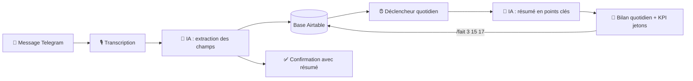
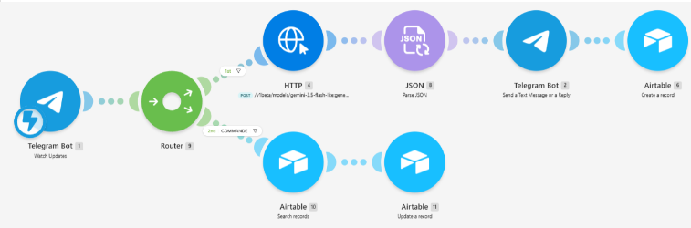
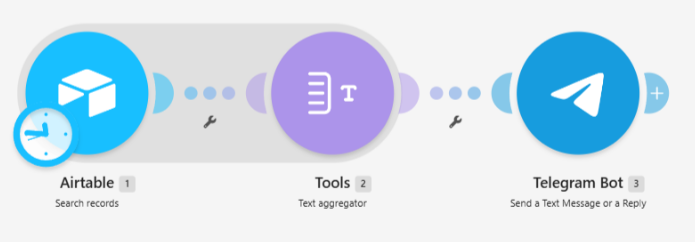
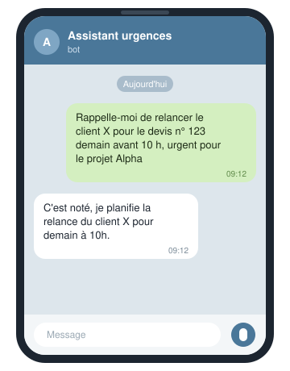
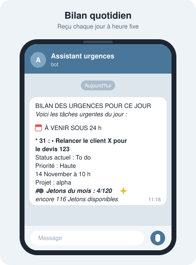

# 🗓️ Organisateur d'urgences : un assistant personnel no-code

> **Dictez une urgence, l'IA la classe, et chaque matin vous recevez votre journée résumée sur Telegram.**
>
  <p align="center">
  <a href="https://youtu.be/TDuycLjmklA">
    
  </a>
  <br>
  <sub>▶️ Présentation en 3 minutes, générée avec NotebookLM (Gemini). Ctrl + clic pour l'ouvrir dans un nouvel onglet autrement click sur le bouton arrier pour revenir à cette page.
  <br>
    <a href="https://youtu.be/TDuycLjmklA">
    Voir la présentation Ctrl + click
  </a>
  </sub>
</p>

## ✨ En bref

- 🎤 **Une phrase suffit** : l'urgence se dicte en vocal ou s'écrit, l'IA la structure toute seule
- 💬 **Confirmation immédiate** : un résumé de ce que l'IA a compris revient aussitôt
- ⏰ **Bilan quotidien** : les urgences du jour et des prochaines 24 h arrivent à heure fixe
- ✅ **Clôture en un message** : chaque action a un numéro unique, affiché dans le bilan quotidien. `/fait 12` suffit pour la terminer

## 🎯 Le problème

Un auto-entrepreneur jongle entre devis, projets clients et urgences de dernière minute. Noter une relance dans un agenda classique demande d'ouvrir l'application, de chercher la date, l'heure, de tout saisir. Résultat : on repousse, on oublie, et l'urgence devient un problème.

## 💡 La solution

Un assistant qui fonctionne avec **une seule action : envoyer un message, écrit ou vocal**.

**Exemple de message :**

> « Rappelle-moi de relancer le client X pour le devis n° 123 demain avant 10 h, c'est urgent pour le projet Alpha. »

## 📱 Pourquoi plutôt qu'un agenda de téléphone ?

C'est le cœur du projet : **moins d'efforts pour noter, moins d'efforts pour mettre à jour**.

| | Agenda standard | Organisateur d'urgences |
| --- | --- | --- |
| **Ajouter** | Ouvrir l'app, choisir date, heure, titre | Dicter une phrase |
| **Priorité** | Souvent absente | Détectée par l'IA |
| **Vérifier** | Relire soi-même | Résumé de confirmation immédiat |
| **Vue d'ensemble** | Une liste d'événements | Un bilan quotidien priorisé |
| **Clôturer** | Ouvrir, chercher, cocher | `/fait 12` (ou plusieurs : `/fait 3 15 17`) |
| **Historique** | Selon l'app | Conservé dans la base, prêt pour l'analyse |

## 🔄 Fonctionnement



### Scénario 1 : réception et clôture des messages



1. **Déclencheur Telegram** : le scénario démarre à chaque message reçu.
2. **Routeur** : si le message commence par `/fait` ou `/done`, il part vers la clôture ; sinon, vers l'ajout.
3. **Transcription** (si vocal) : le message audio est converti en texte.
4. **IA (Gemini)** : extraction des champs (titre, type, projet, date limite, priorité).
5. **Airtable** : création de l'action avec le statut *To do*.
6. **Confirmation** : un résumé de ce que l'IA a compris est renvoyé sur Telegram.
7. **Branche `/fait`** : récupération des numéros, puis passage du statut à *Fait* dans Airtable.

### Scénario 2 : bilan quotidien



1. **Déclencheur planifié** : lancement chaque jour à heure fixe.
2. **Airtable** : recherche des actions *To do* ou *In progress* à échéance du jour ou des 24 h suivantes.
3. **IA (Gemini)** : rédaction du bilan en points clés, avec l'identifiant de chaque action.
4. **Calcul du KPI** : nombre de jetons utilisés ce mois-ci sur le budget de 120.
5. **Telegram** : envoi du bilan et du solde de jetons.

## 🔍 En pratique

**Chaque action reçoit un numéro unique** à sa création (champ ID d'Airtable, jamais réutilisé). Ce numéro apparaît dans le bilan quotidien : c'est lui qu'on envoie pour clôturer.

<table width="100%">
<tr>
<td width="50%" align="center" valign="top"></td>
<td width="50%" align="center" valign="top"></td>
</tr>
</table>

**Clôture** : dans le bilan ci-dessus, `/fait 31 15 17` passe les actions `#31`, `#15` et `#17` au statut *Fait*. Elles quittent le bilan mais restent dans la base.

## 🧪 Tests : performance contre crédits

Les tests ont porté sur une seule question : **quelles fonctionnalités ajouter pour rendre l'assistant performant, tout en restant dans les 1 000 crédits mensuels de la version gratuite de Make ?**

Chaque module exécuté consomme des crédits. Ajouter un module améliore la précision ou le confort d'usage, mais réduit la durée pendant laquelle le projet peut tourner. J'ai donc testé chaque fonctionnalité en mesurant son coût.

| Fonctionnalité testée | Apport pour l'utilisateur | Décision |
| --- | --- | --- |
| Transcription vocale | Dicter au lieu de taper | ✅ Gardée |
| Extraction des champs par l'IA | Plus de saisie manuelle | ✅ Gardée |
| Confirmation avec résumé | Vérifier en une seconde | ✅ Gardée |
| Clôture `/fait` | Terminer sans ouvrir d'application | ✅ Gardée |
| Clôture groupée (`/fait 3 15 17`) | Moins de crédits consommés | ✅ Gardée |
| Réception automatique du bilan |La journée est organisée par priorités | ✅ Gardé |
| Suivi des jetons dans le bilan |Piloter sa consommation | ✅ Gardé |

### Calcul du budget et période de déploiement

```
Consommation mensuelle = (ajouts × crédits par ajout)
                       + (clôtures × crédits par clôture)
                       + (30 bilans × crédits par bilan)

Période de déploiement = 1 000 crédits ÷ consommation moyenne par jour
```

Avec 5 crédits par ajout, 2+N (N=nombre d'action cloturées dans le même message) par clôture et [3] par bilan, le budget de **120 jetons** (1 jeton = 1 ajout) correspond à **890 crédits** par mois. L'assistant peut donc fonctionner **30 jours** sur une période de réinitialisation, avec **110 crédits** de marge.

**Compromis assumé :** les clôtures groupées économisent des crédits, mais le bilan peut afficher pendant 2 ou 3 jours des actions déjà faites. Avec une licence Core ou Pro, cette contrainte disparaît.

## 🤖 Le prompt d'extraction

Le prompt transforme une phrase libre en champs structurés (titre, type, projet, date limite, priorité).

<details>
<summary>Voir le prompt Gemini</summary>

```text
{
  "contents": [
    {
      "parts": [
        {
          "text": "Tu es BrainDump, un assistant personnel qui répond en français de façon naturelle, utile et concise.
\n\nAnalyse le message de l'utilisateur et extrais les informations utiles pour organiser ses idées.
\n\nRéponds exclusivement avec un objet JSON valide contenant exactement ces six champs :
\n- \"type\" : une seule catégorie parmi \"Tâche\", \"Événement\", \"Risque\", \"Information\".\n- \"reponse\"
: une réponse naturelle, utile et concise à l'utilisateur.\n- \"date_limite\" : date et heure au format ISO 8601 si une échéance précise est mentionnée, sinon null.
Ne devine jamais une date.\n- \"priorite\" : \"Haute\", \"Normale\" ou \"Basse\", selon l'urgence exprimée.
Si rien ne permet de déterminer l'urgence, choisir \"Normale\".\n- \"prochaine_action\" :
 une action concrète et courte si elle est identifiable, sinon null.\n- \"projet\" :
nom du projet auquel le message se rattache, déduit du contexte si possible.
Si aucun projet ne peut être identifié de façon raisonnable, renvoie null. N'invente jamais un projet.
\n\nDate et heure actuelles : {{formatDate(now; "YYYY-MM-DD HH"; "Europe/Paris")}}
\n\nUtilise cette date et heure comme référence pour interpréter aujourd'hui, demain ou dans trois jours.
Convertis toute échéance identifiable en date et heure ISO 8601.
Si seule une date est précisée sans heure, ne crée pas d'heure arbitraire.
Si l'échéance est ambiguë, renvoie null.N'invente jamais un projet.\n\nN'ajoute aucun texte avant ou après le JSON.
\n\nMessage utilisateur : {{1.message.text}}"
        }
      ]
    }
  ],
  "generationConfig": {
    "temperature": 0.2,
    "responseMimeType": "application/json"
  }
}
```

## 🤖 Gemini à l'œuvre

Gemini intervient deux fois : il **structure** chaque message, puis **rédige** le bilan quotidien.

| Ce que j'écris | Ce que Gemini en extrait |
| --- | --- |
| « Rappelle-moi de relancer le client X pour le devis 123 demain avant 10 h, urgent pour le projet Alpha » | **31 - Relancer le client X pour le devis 123**<br>**Status actuel** : To do <br>**Priorité** : Haute<br>14 November à 10 h<br>**Projet** : Alpha |

</details>

**Ce que le prompt impose :**
- Le format de sortie attendu: application JSON qui permet de remplir les champs dans Airtable de façon structurée sans création d'erreurs
- La priorité et les dates sont converties et standardisés depuis un message vocal avec termes familiers ("ex: demain")
- Si une information est manquante l'application ne s'arrête pas, mais prévois des champs vides et, surtout, ne les invente pas 

## 🗃️ Structure de la base de données

| Champ | Type | Exemple |
| --- | --- | --- |
| ID | Numéro automatique | 15 |
| Titre | Texte | Rappelle-moi de renvoyer le devis à jour pour le client X demain à 10h, c'est très urgent ! Projet : Alpha |
| Type | Choix | Tâche / Évènement / Risque / Information |
| Projet | Texte | Alpha |
| Date limite | Date et heure | 16/10/2026 10:00 |
| Priorité | Choix | Haute / Normale / Basse |
| Statut | Choix | To do / In progress / Fait / Annulé |
| Description | Texte | C'est noté, je planifie l'envoi du devis à X pour demain à 10h. |
| Date de création | Date et heure | 15/10/2026 10:00 |

## 🪙 Contrainte de coût : la version gratuite de Make

La version gratuite offre 1 000 crédits par mois. J'ai donc fixé un budget de **120 jetons par mois** (1 jeton = 1 action ajoutée), soit environ 4 actions par jour **en moyenne, pas en plafond**. Le reste des crédits est réservé aux confirmations, aux clôtures et au bilan. Le solde est affiché à la fin de chaque bilan.

**Compromis assumé :** les clôtures groupées économisent des crédits, mais le bilan peut afficher 2 ou 3 jours des actions déjà faites. Avec une licence Core ou Pro, cette contrainte disparaît.

| Action | Moyenne conseillée par jour | Compte dans le compteur ? |
|---|---|---|
| ➕ Ajout d'une urgence (1 message par urgence) | **3 actions distinctes** | ✅ Oui, 1 jeton par action |
| ✅ Clôture d'actions (`/fait`) | **1 message regroupant 3 actions ou plus** | ❌ Non, déjà inclus dans le budget |

**Une moyenne, pas un plafond.** L'application ne bloque jamais l'utilisateur à la troisième action :

- Il peut enregistrer **10 urgences un jour** s'il sait que les jours suivants seront plus calmes.
- Il peut envoyer **un `/fait` pour une seule action**, s'il prévoit d'en clôturer 7 d'un coup le lendemain.

Ce qui compte, c'est l'équilibre sur le mois.

## 🧰 Outils utilisés

- **Make** : orchestration des scénarios
- **Airtable** : base de données des urgences
- **Gemini** : analyse du langage naturel et rédaction des résumés
- **Telegram** : canal d'échange (messages, confirmations, bilan, commandes)

## 🎓 Compétences démontrées

- **Analyse du besoin** : partir d'un problème réel (l'urgence oubliée) et le traduire en parcours simple
- **Conception de base de données** : modèle Airtable avec identifiant unique, types, priorités et statuts
- **Prompt engineering** : transformer une phrase libre en champs structurés avec Gemini
- **Automatisation no-code** : deux scénarios Make reliés à Telegram et Airtable
- **Arbitrage coût / performance** : mesurer le coût de chaque module et dimensionner un budget mensuel
- **Approche produit** : confirmation immédiate, clôture par commande, bilan priorisé
- **Préparation à l'analyse** : historique conservé pour un futur dashboard Power BI

## 🔮 Pistes d'amélioration

- Tableau de bord **Power BI** : urgences par client, par priorité, délais de traitement
- Synchronisation avec un agenda existant
- Relance automatique des urgences non traitées
- Clôture en temps réel avec une licence payante

---

*Projet conçu en no-code avec l'appui de l'IA générative, dans le cadre de ma formation INKREA (2026).*
