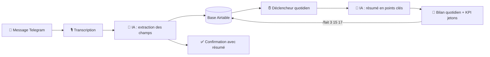

# 🗓️ Organisateur d'urgences : un assistant personnel no-code

> **Dictez une urgence, l'IA la classe, et chaque matin vous recevez votre journée résumée sur Telegram.**

## ✨ En bref

- 🎤 **Une phrase suffit** : l'urgence se dicte en vocal ou s'écrit, l'IA la structure toute seule
- 💬 **Confirmation immédiate** : un résumé de ce que l'IA a compris revient aussitôt
- ⏰ **Bilan quotidien** : les urgences du jour et des prochaines 24 h arrivent à heure fixe
- ✅ **Clôture en un message** : chaque action a un numéro unique, affiché dans le bilan quotidien. `/fait 12` suffit pour la terminer

## 🎯 Le problème

Un auto-entrepreneur jongle entre devis, projets clients et urgences de dernière minute. Noter une relance dans un agenda classique demande d'ouvrir l'application, de chercher la date, l'heure, de tout saisir. Résultat : on repousse, on oublie, et l'urgence devient un problème.

## 💡 La solution

Un assistant qui fonctionne avec **une seule action : envoyer un message, écrit ou vocal**.

**Exemple de message :**

> « Rappelle-moi de relancer le client X pour le devis n° 123 demain avant 10 h, c'est urgent pour le projet Alpha. »

## 📱 Pourquoi plutôt qu'un agenda de téléphone ?

C'est le cœur du projet : **moins d'efforts pour noter, moins d'efforts pour mettre à jour**.

| | Agenda standard | Organisateur d'urgences |
| --- | --- | --- |
| **Ajouter** | Ouvrir l'app, choisir date, heure, titre | Dicter une phrase |
| **Priorité** | Souvent absente | Détectée par l'IA |
| **Vérifier** | Relire soi-même | Résumé de confirmation immédiat |
| **Vue d'ensemble** | Une liste d'événements | Un bilan quotidien priorisé |
| **Clôturer** | Ouvrir, chercher, cocher | `/fait 12` (ou plusieurs : `/fait 3 15 17`) |
| **Historique** | Selon l'app | Conservé dans la base, prêt pour l'analyse |

## 🔄 Fonctionnement



### Scénario 1 : réception et clôture des messages


1. **Déclencheur Telegram** : le scénario démarre à chaque message reçu.
2. **Routeur** : si le message commence par `/fait` ou `/done`, il part vers la clôture ; sinon, vers l'ajout.
3. **Transcription** (si vocal) : le message audio est converti en texte.
4. **IA (Gemini)** : extraction des champs (titre, type, projet, date limite, priorité).
5. **Airtable** : création de l'action avec le statut *To do*.
6. **Confirmation** : un résumé de ce que l'IA a compris est renvoyé sur Telegram.
7. **Branche `/fait`** : récupération des numéros, puis passage du statut à *Fait* dans Airtable.

### Scénario 2 : bilan quotidien


1. **Déclencheur planifié** : lancement chaque jour à heure fixe.
2. **Airtable** : recherche des actions *To do* ou *In progress* à échéance du jour ou des 24 h suivantes.
3. **IA (Gemini)** : rédaction du bilan en points clés, avec l'identifiant de chaque action.
4. **Calcul du KPI** : nombre de jetons utilisés ce mois-ci sur le budget de 120.
5. **Telegram** : envoi du bilan et du solde de jetons.

## 🔍 En pratique

**Chaque action reçoit un numéro unique** à sa création (champ ID d'Airtable, jamais réutilisé). Ce numéro apparaît dans le bilan quotidien : c'est lui qu'on envoie pour clôturer.

**Confirmation après chaque ajout** (exemple fictif) :

```
Vous :      Rappelle-moi de relancer le client X pour le devis n° 123
            demain avant 10 h, urgent pour le projet Alpha
Assistant : C'est noté, je planifie la relance du client X
            pour demain à 10h.
```

**Bilan quotidien** (exemple fictif) :

```
Bilan du jour
1. [#3]  Relancer le client X, devis n° 123 (avant 10 h) : URGENT
2. [#15] Envoyer la facture du projet Alpha
3. [#17] Préparer le rendez-vous de jeudi

Jetons du mois : 14/120 · encore 106 disponibles
```

**Clôture** : dans le bilan ci-dessus, `/fait 3 15 17` passe les actions `#3`, `#15` et `#17` au statut *Fait*. Elles quittent le bilan mais restent dans la base.

## 🗃️ Structure de la base de données

| Champ | Type | Exemple |
| --- | --- | --- |
| ID | Numéro automatique | 15 |
| Titre | Texte | Rappelle-moi de renvoyer le devis à jour pour le client X demain à 10h, c'est très urgent ! Projet : Alpha |
| Type | Choix | Tâche / Évènement / Risque / Information |
| Projet | Texte | Alpha |
| Date limite | Date et heure | 16/10/2026 10:00 |
| Priorité | Choix | Haute / Normale / Basse |
| Statut | Choix | To do / In progress / Fait / Annulé |
| Description | Texte | C'est noté, je planifie l'envoi du devis à X pour demain à 10h. |
| Date de création | Date et heure | 15/10/2026 10:00 |

## 🪙 Contrainte de coût : la version gratuite de Make

La version gratuite offre 1 000 crédits par mois. J'ai donc fixé un budget de **120 jetons par mois** (1 jeton = 1 action ajoutée), soit environ 4 actions par jour **en moyenne, pas en plafond**. Le reste des crédits est réservé aux confirmations, aux clôtures et au bilan. Le solde est affiché à la fin de chaque bilan.

**Compromis assumé :** les clôtures groupées économisent des crédits, mais le bilan peut afficher 2 ou 3 jours des actions déjà faites. Avec une licence Core ou Pro, cette contrainte disparaît.

| Action | Moyenne conseillée par jour | Compte dans le compteur ? |
|---|---|---|
| ➕ Ajout d'une urgence (1 message par urgence) | **3 actions distinctes** | ✅ Oui, 1 jeton par action |
| ✅ Clôture d'actions (`/fait`) | **1 message regroupant 3 actions ou plus** | ❌ Non, déjà inclus dans le budget |

**Une moyenne, pas un plafond.** L'application ne bloque jamais l'utilisateur à la troisième action :

- Il peut enregistrer **10 urgences un jour** s'il sait que les jours suivants seront plus calmes.
- Il peut envoyer **un `/fait` pour une seule action**, s'il prévoit d'en clôturer 7 d'un coup le lendemain.

Ce qui compte, c'est l'équilibre sur le mois.

## 🧰 Outils utilisés

- **Make** : orchestration des scénarios
- **Airtable** : base de données des urgences
- **Gemini** : analyse du langage naturel et rédaction des résumés
- **Telegram** : canal d'échange (messages, confirmations, bilan, commandes)

## 🔮 Pistes d'amélioration

- Tableau de bord **Power BI** : urgences par client, par priorité, délais de traitement
- Synchronisation avec un agenda existant
- Relance automatique des urgences non traitées
- Clôture en temps réel avec une licence payante

---

*Projet conçu en no-code avec l'appui de l'IA générative, dans le cadre de ma formation INKREA (2026).*
